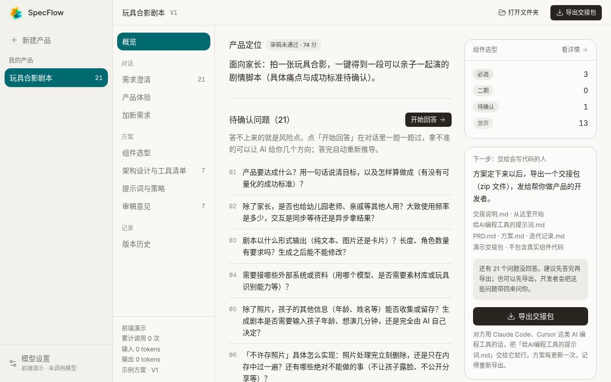

<p align="center">
  
</p>

<h1 align="center">SpecFlow</h1>

<p align="center">从一个产品想法，到清晰、可执行、可交接的 Agent 产品方案。</p>

<p align="center">
  <a href="https://xuguang-agent-studio.chengjain.chatgpt.site">在线体验</a>
  ·
  <a href="#快速开始">快速开始</a>
  ·
  <a href="#功能亮点">功能亮点</a>
</p>



## 产品简介

SpecFlow 是一套面向 AI 产品设计与开发交接的工作台。它把需求澄清、产品方案、组件选型、架构设计、提示词策略、产品体验和版本迭代串成一条完整流程，让模糊想法逐步变成可以直接交给开发团队的产品规格。

当前仓库提供完整前端和浏览器体验模式。体验数据保存在本地浏览器中，不需要 API Key，也不会上传用户输入。

## 功能亮点

- **需求澄清**：逐题确认目标用户、核心闭环、成功标准和安全边界。
- **产品方案**：整理产品定位、需求拆解、能力组件与关键决策。
- **架构设计与工具清单**：输出七层架构、工具输入输出、权限和副作用。
- **提示词与策略**：集中呈现系统提示词、上下文、记忆、安全和降级策略。
- **产品体验**：以用户身份测试交互，记录“这里不对”，并带入下一轮迭代。
- **版本管理**：保留 PRD 快照、需求变更和产品版本记录。
- **开发交接**：导出 PRD、方案、开发提示词和迭代记录。
- **项目管理**：支持新建产品、右键删除项目及删除前二次确认。
- **响应式界面**：适配桌面与移动端，支持键盘导航。

## 快速开始

需要 Node.js 22.12 或更高版本。

```bash
npm ci
npm run dev
```

打开终端输出的本地地址即可。默认运行浏览器体验模式，所有产品与对话数据保存在 `localStorage`。

构建生产静态文件：

```bash
npm run build
npm run preview
```

构建结果位于 `dist/`。

## 连接 SpecFlow Engine

前端保留了完整的 HTTP API 与 NDJSON 流式对话契约。设置 `VITE_ENGINE=1` 后，前端会关闭浏览器模拟数据并请求真实服务端。

```bash
npm run dev:engine
```

开发代理默认指向 `http://127.0.0.1:8765`，可以在 `vite.config.ts` 中调整。

服务端需实现产品、方案、对话、版本、导出与项目删除接口。其中删除项目使用：

```text
DELETE /api/products/:slug
```

## 常用命令

```bash
npm run dev          # 启动浏览器体验模式
npm run dev:engine   # 连接真实服务端
npm run build        # 构建静态站点
npm run build:engine # 构建服务端托管版本
npm run lint         # 代码检查
```

## 技术栈

- React 19 + TypeScript
- Vite
- Tailwind CSS
- assistant-ui
- Base UI
- Lucide Icons
- Sonner

## 主要目录

```text
src/
├── components/       通用界面、对话运行时与工具卡片
├── lib/              API、路由和浏览器体验数据
├── pages/            产品、方案、体验、历史和设置页面
├── App.tsx           应用外壳与项目导航
└── studio.css        SpecFlow 视觉系统与响应式布局

public/
├── specflow-icon.png
└── favicon.png
```

## License

[MIT](LICENSE) © 2026 SpecFlow
